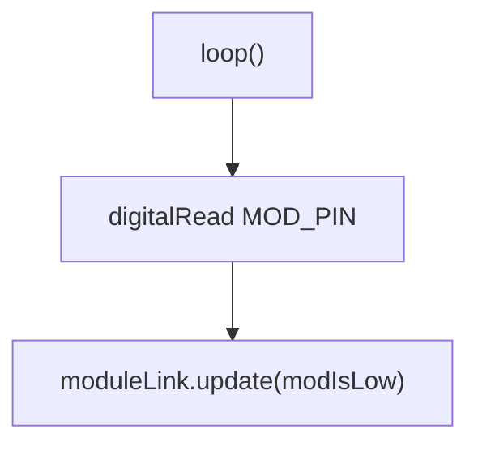

# Firmware architecture

[Home](home.md) · Reference: [Architecture](reference/architecture.md)

## Summary

This firmware runs on the ATmega328PB solenoid daughterboard. The ESP32
motherboard is the I2C master. Plugging the board in is enough for the
motherboard to assign an address and identify a solenoid module.

`src/main.cpp` is the composition root. It owns the pin constants and
the product settings, constructs the adapter and the link, and calls
`update()` on the link. Solenoid outputs stay off.

## Where it sits

Global construction runs before `setup()`. `ModuleLink` registers its
master-write handler there. The slave stays off until `loop()` sees
MOD low.

The motherboard bus is this chip's TWI0. PC4 is SDA and PC5 is SCL.
MiniCore numbers those 18 and 19. Arduino `Wire` is that peripheral.
`Wire` takes no pin arguments.

## What it creates

```text
main.cpp
  AvrTwi0Slave    TWI0 adapter for IModuleSlavePort
  ModuleLink      MOD gate, frames, and replies
```

`main.cpp` passes `MODULE_TYPE` and `FIRMWARE_VERSION` into the link.
Pin numbers stay in `main.cpp`.

`lib/Interfaces/` holds `IModuleSlavePort` and the copied
`ModuleProtocol.h`. `lib/Drivers/` holds the AVR adapter. `lib/Logic/`
holds the link. Desktop fakes live in `test/test_desktop/fakes/`.

## One update

`setup()` drives each solenoid enable, each pulse enable, and
`S_PWR_EN_PIN` low, leaves the sense pins as inputs, drives `SNS_PIN`
low, and holds `MOD_PIN` as an input with pull-up. The enables go low
before SNS, so the host does not see the board until those outputs
are off.



`loop()` does not block, so a low MOD is seen inside `kModGateMaxMs`.
While the module has no address, MOD low enables `0x0A` and MOD high
disables it. After a valid `SET_ADDRESS`, the link keeps that address
when MOD rises.

## What is stored, and who reads it

Each pass reads `MOD_PIN` and passes that level to the link. The
motherboard reads the sense line, which `SNS_PIN` holds low.

The link stores the address and whether it has been assigned. The TWI0
adapter stores the reply the host clocks out. Those stores are on the
[module link](module-link.md) and [slave port](slave-port.md) pages.

## See also

- [Architecture reference](reference/architecture.md) — pins, the pass, the image build.
- [Module link](module-link.md)
- [Slave port](slave-port.md)
