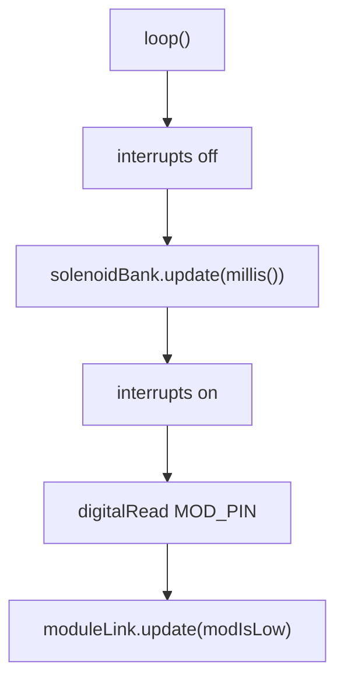

# Firmware architecture

[Home](home.md) · Reference: [Architecture](reference/architecture.md)

## Summary

This firmware runs on the ATmega328PB solenoid daughterboard. The ESP32
motherboard is the I2C master. Plugging the board in is enough for the
motherboard to assign an address and identify a solenoid module.

`src/main.cpp` is the composition root. It owns the pin constants and
the product settings, constructs the bus adapter, the solenoid port,
the bank, and the link, and calls `update()` on the bank and on the
link. Channels stay off until a set command. The hold rail turns on
after the first loop.

## Where it sits

Global construction runs before `setup()`. `ModuleLink` registers its
master-write handler there. The slave stays off until `loop()` sees
MOD low.

The motherboard bus is this chip's TWI0. PC4 is SDA and PC5 is SCL.
MiniCore numbers those 18 and 19. Arduino `Wire` is that peripheral.
`Wire` takes no pin arguments.

## What it creates

```text
main.cpp
  AvrTwi0Slave       TWI0 adapter for IModuleSlavePort
  AvrSolenoidPort    switch adapter for ISolenoidPort
  SolenoidBank       pulse, hold, and silence
  ModuleLink         MOD gate, frames, and replies
```

`main.cpp` passes `MODULE_TYPE`, `FIRMWARE_VERSION`, and
`SolenoidConfig` in. Pin numbers stay in `main.cpp`.

`lib/Interfaces/` holds the ports and the copied `ModuleProtocol.h`.
`lib/Drivers/` holds the AVR adapters. `lib/Logic/` holds the bank and
the link. Desktop fakes live in `test/test_desktop/fakes/`.

## One update

`setup()` calls `solenoidPort.begin()`, which drives each solenoid
enable, each pulse enable, each capacitor switch, `PULSE_T_PIN`, and
`S_PWR_EN_PIN` low, then sets each as an output. It leaves
`S_PWR_PG_PIN` and `SNS_1_PIN` through `SNS_4_PIN` as inputs, drives
`SNS_PIN` low, and holds `MOD_PIN` as an input with pull-up. The
switches go low before SNS, so the host does not see the board until
those outputs are off. The hold rail stays off until the first loop.



The first `update()` turns the hold rail on and leaves it on. A
channel stays off until `SET_SOLENOID`. `loop()` does not block, so a
low MOD is seen inside `kModGateMaxMs`. While the module has no
address, MOD low enables `0x0A` and MOD high disables it. After a
valid `SET_ADDRESS`, the link keeps that address when MOD rises.

## What is stored, and who reads it

Each pass reads `millis()` for the bank and `MOD_PIN` for the link.
The motherboard reads the sense line, which `SNS_PIN` holds low.

The bank stores the desired bits, the holding bits, and its two
clocks. The link stores the address and whether it has been assigned.
The TWI0 adapter stores the reply the host clocks out. Those stores
are on the [solenoid bank](solenoid-bank.md),
[module link](module-link.md), and [slave port](slave-port.md) pages.

## See also

- [Architecture reference](reference/architecture.md) — pins, settings, the pass, the image build.
- [Solenoid bank](solenoid-bank.md)
- [Module link](module-link.md)
- [Slave port](slave-port.md)
