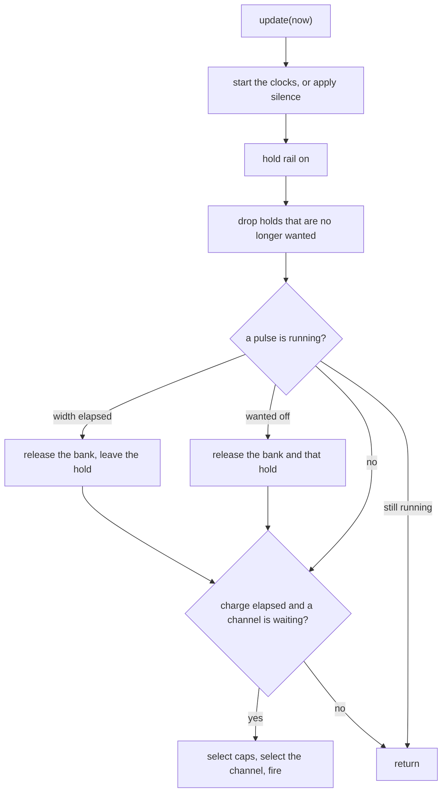

# Solenoid bank

[Home](home.md) · Reference: [Solenoid bank](reference/solenoid-bank.md)

## Summary

`SolenoidBank` turns four sprinkler channels on and off. A turn-on
dumps a set number of capacitors into one channel, then leaves that
channel on the hold rail. A turn-off drops the hold. The hold rail
itself stays on after the first pass.

The motherboard sends `SET_SOLENOID`. The handler stores the request
and replies. The pulse runs later, from `update()`.

## Where it sits

`main.cpp` constructs `AvrSolenoidPort` and `SolenoidBank`, then passes
the bank into `ModuleLink`. `loop()` calls `solenoidBank.update(millis())`
with interrupts off, then `moduleLink.update(modIsLow)`.

`setDesired()` and `state()` run from the TWI handler. They do not
move the switches.

## What it creates

```text
SolenoidBank
  ISolenoidPort    hold rail, S_EN, P_EN, C_S, PULSE_T
```

The bank does not create the port. `main.cpp` does. The AVR adapter
is `AvrSolenoidPort`. Desktop tests use `FakeSolenoidPort`.

## One update



The capacitors charge while they are off the bank. The wait, when
there is one, finishes before they are selected. One channel pulses
at a time. The order and the replies are on the
[reference](reference/solenoid-bank.md).

## What is stored, and who reads it

Each channel has a desired bit and a holding bit. `setDesired()`
writes the desired bit. `state()` and the link read both.

`_lastReleaseMs` is the charge clock. It starts on the first
`update()`, and again when a pulse releases the bank. `_silenceAnchor`
is the last accepted set, or the first `update()` when none has
arrived. The link does not read those clocks.

The port stores nothing the bank reads back. The bank writes the
switch levels.

## See also

- [Solenoid bank reference](reference/solenoid-bank.md) — states, the pulse, silence, tests.
- [Module link](module-link.md)
- [Architecture](architecture.md)
